<div align="center">

## 💊 LABEL: Literature Asymmetry between Efficacy and Limits in Drug Knowledge and Language Models


[](LICENSE)
[](#-run-it)
[](DATA.md)
[](#-run-it)

`drug safety` · `knowledge graphs` · `language models` · `retrieval` · `abstention`

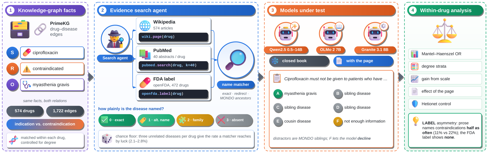

</div>

---

## 🧩 The problem

Every drug has two kinds of facts.

| ✅ Efficacy | ⛔ Limits |
|---|---|
| What the drug **treats** | Who must **not** take it |
| *naproxen treats gout* | *naproxen must not go to people with an active peptic ulcer* |
| The graph calls it an **indication** | The graph calls it a **contraindication** |

Both facts matter. A wrong limit can hurt a patient.

But people write about the good side much more than the risky side.
Language models learn from that writing. So they may learn what a drug treats, and miss who must avoid it.

> **Our question:** Does text name a drug's limits less often than its efficacy? And do language models follow that gap?

---

## 🎯 What we do

- 🔎 **We measure** how often text names each drug fact. We use three sources: Wikipedia, PubMed, and the FDA drug label.
- ⚖️ **We compare** efficacy and limits *inside the same drug*. So a famous drug cannot skew the result.
- 🤖 **We test** 7 language models on the same facts, from 0.5B to 14B parameters.
- 📄 **We give** the models a page to read, and we check if the page helps.
- 🧭 **We present** a simple rule: ask the FDA label about limits, not prose.

We call the gap the **LABEL asymmetry**.

---

## 📚 The data

<div align="center">
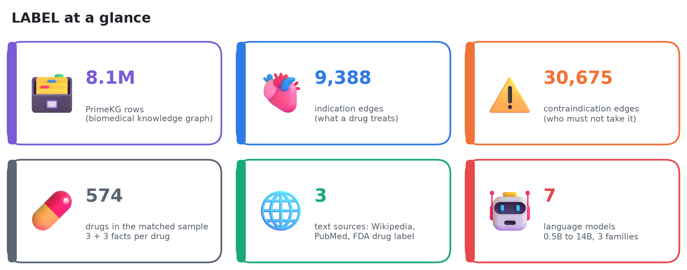
</div>

### What PrimeKG looks like

PrimeKG is a big biomedical **knowledge graph**. Each row links two things with a relation.
We use the drug → disease links. MONDO gives each disease its parent family.

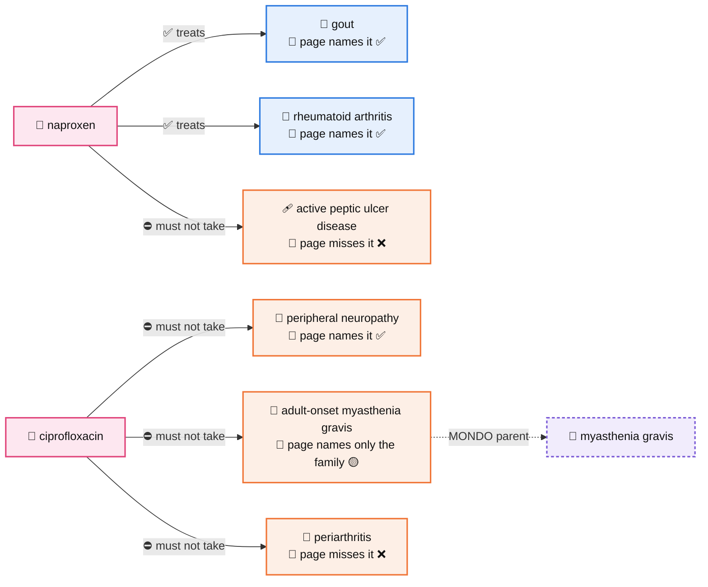

These are real rows from our sample, with what each drug's Wikipedia page says.
Naproxen's page names its uses but not the ulcer risk.
Ciprofloxacin's page says "myasthenia gravis" but not *which* kind. The models then pick the wrong sibling, such as *myasthenia gravis with thymus hyperplasia*.
The FDA label for ciprofloxacin carries a **Boxed Warning** about myasthenia gravis.

### The numbers

| Item | Count |
|---|---:|
| 🗄️ PrimeKG rows | 8,100,498 |
| ✅ Indication edges (drug treats disease) | 9,388 |
| ⛔ Contraindication edges (drug must not go to disease) | 30,675 |
| 🔸 Off-label edges | 2,568 |
| 🔗 Disease → disease edges | 64,388 |
| 📁 MONDO child → parent rows (diseases covered) | 17,801 (11,788) |
| 💊 Drugs in our matched sample | **574** (3 indications + 3 contraindications each) |
| 🏷️ Drugs with an FDA label | 472 |
| ❓ Closed-book questions | 600 per relation, 5 options |
| 🧪 Harder questions (sibling distractors + "Not enough information") | 856 |
| 🧫 Hetionet control: treats / palliates edges | 600 / 385 |

**Why the problem lives in this data:** the graph has *three times more* limits than uses (30,675 vs. 9,388). Yet text names the limits *less*. The graph knows the risk. The prose does not carry it.

Full sources, versions and licenses: [`DATA.md`](DATA.md).

---

## ⚙️ The method

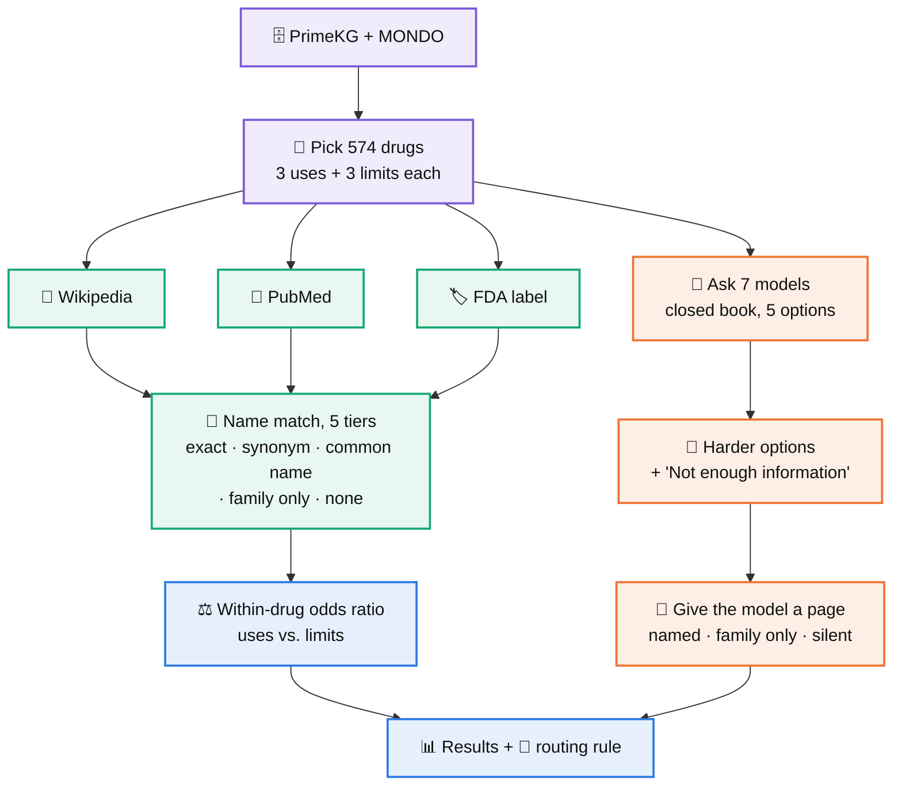

**In plain steps:**

1. 💊 We pick 574 drugs. Each drug gives us 3 uses and 3 limits. So both sides come from the same drugs.
2. 🔎 We look for each disease name in the drug's text. We accept the exact name, a synonym, or a common name. We note when the text names only the disease family.
3. ⚖️ We compare uses and limits with a within-drug odds ratio. An odds ratio of 1 means no gap.
4. 🤖 We ask each model a 5-option question with no text ("closed book").
5. 🧪 We make the question harder: the wrong options come from the same disease family, and we add "Not enough information to tell".
6. 📄 We hand the model a page. The page names the disease, names only its family, or says nothing.

### 🤖 The models

| Model | Size | Family |
|---|---|---|
| Qwen2.5 | 0.5B · 1.5B · 3B · 7B · 14B | Alibaba Qwen |
| OLMo-2 | 7B | AI2 (fully open data) |
| Granite-3.1 | 8B | IBM |

All models run on CPU in fp32. We score each option by its log-probability.

---

## 📊 Results

### 1️⃣ Text names uses about twice as often as limits

<div align="center">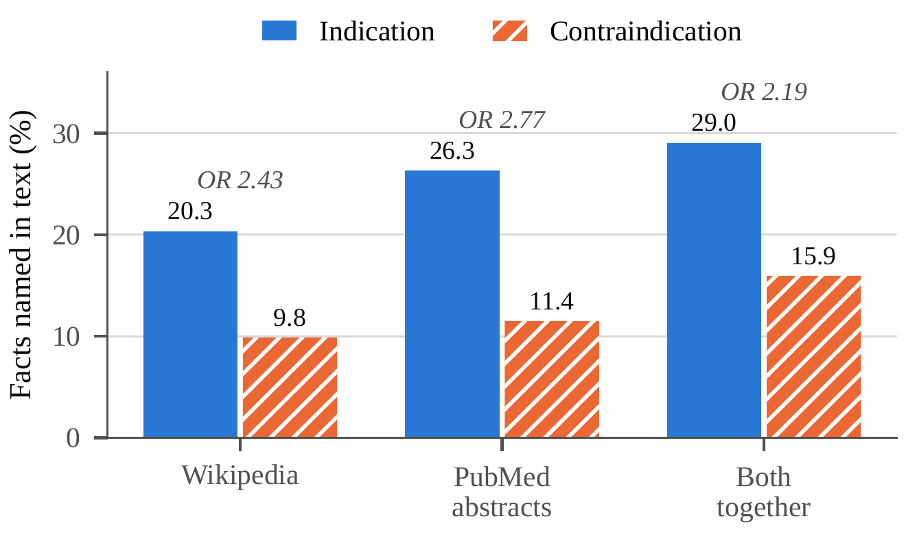</div>

| Source | ✅ Uses named | ⛔ Limits named | Within-drug OR [95% CI] |
|---|---:|---:|---|
| 📖 Wikipedia | 20.3% | 9.8% | **2.43** [1.98, 2.98] |
| 🔬 PubMed | 26.3% | 11.4% | **2.77** [2.30, 3.33] |
| 📖 + 🔬 Both | 29.0% | 15.9% | **2.19** [1.85, 2.59] |

Intervals use the Robins-Breslow-Greenland variance.

**What it means:** in every prose source, a limit is less than half as likely to show up as a use of the same drug.

### 2️⃣ The FDA label has no gap

<div align="center">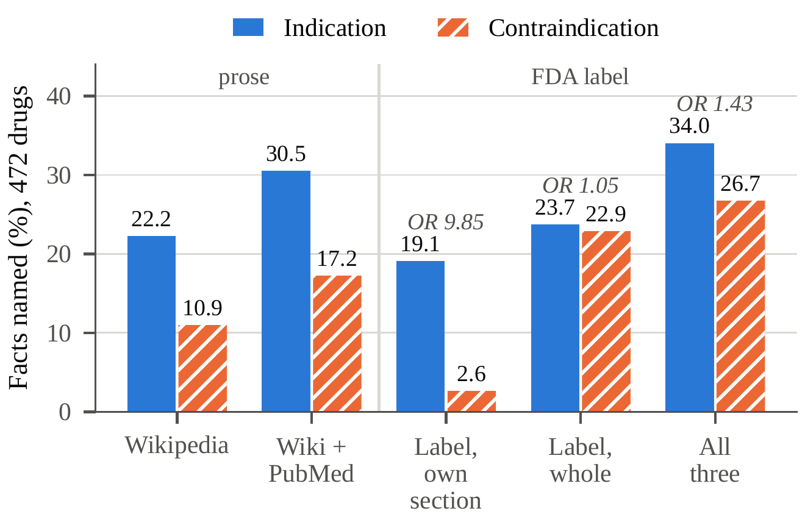</div>

| Source | ✅ Uses | ⛔ Limits | OR |
|---|---:|---:|---|
| 🏷️ Whole FDA label (472 drugs) | 23.7% | 22.9% | **1.05** [0.88, 1.25] |
| 🏷️ Only its "Contraindications" section | – | 2.6% | – |

<div align="center">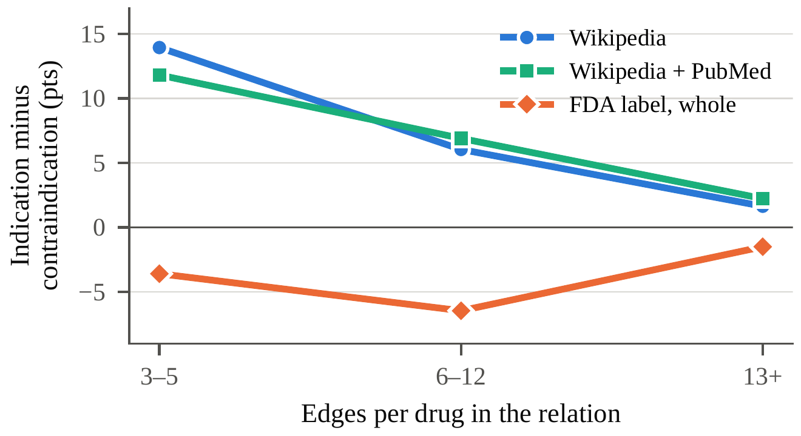</div>

The gap holds for drugs with few edges and drugs with many. Prose favors uses in every group. The whole label does not.

**What it means:** the same matcher finds limits fine in the label. So the gap comes from the prose, not from our matcher.
One surprise: the label rarely lists these limits in its own *Contraindications* section. They sit in warnings and other sections.

### 3️⃣ Bigger models learn uses, not limits

<div align="center">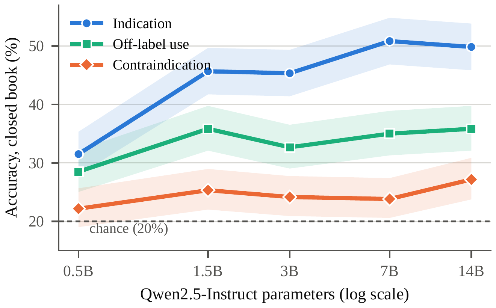</div>

| Model | ✅ Uses | 🔸 Off-label | ⛔ Limits | Gap |
|---|---:|---:|---:|---:|
| Qwen2.5-0.5B | 31.5 | 28.5 | 22.2 | +9.3 |
| Qwen2.5-1.5B | 45.7 | 35.8 | 25.3 | +20.3 |
| Qwen2.5-3B | 45.3 | 32.7 | 24.2 | +21.2 |
| Qwen2.5-7B | 50.8 | 35.0 | 23.8 | +27.0 |
| Qwen2.5-14B | 49.8 | 35.8 | 27.2 | +22.7 |

Accuracy in %, closed book, chance = 20%.
**What it means:** use accuracy climbs with size. Limit accuracy stays near chance at every size.

### 4️⃣ Harder questions: each model fails in its own way

<div align="center">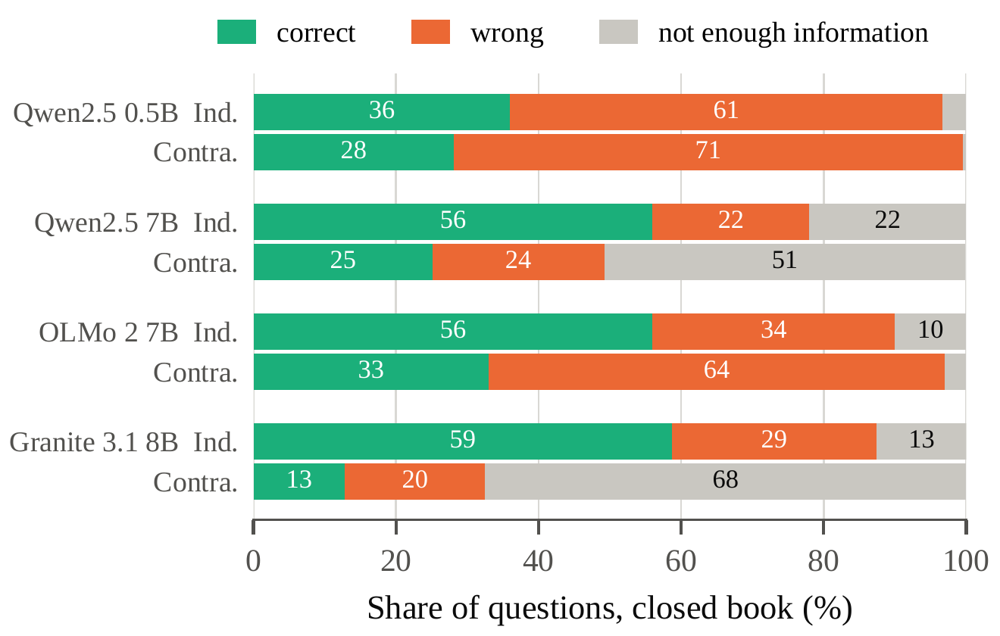</div>

| Model | ✅ Uses correct | ⛔ Limits correct | Gap | ⛔ Wrong | ⛔ Declined | ⛔ Precision |
|---|---:|---:|---:|---:|---:|---:|
| Qwen2.5-0.5B | 36.0 | 28.1 | +7.9 | 71.4 | 0.5 | 28.2 |
| Qwen2.5-7B | 56.0 | 25.1 | +30.9 | 24.1 | 50.7 | 51.0 |
| OLMo-2-7B | 56.0 | 33.0 | +23.0 | 64.0 | 3.0 | 34.0 |
| Granite-3.1-8B | 58.7 | 12.8 | **+45.9** | 19.7 | 67.5 | 39.4 |

- 🎲 **Qwen2.5-0.5B and OLMo-2-7B guess.** They almost never decline, so most limit answers are wrong.
- 🙅 **Qwen2.5-7B and Granite-3.1-8B decline.** They say "Not enough information" for half or more of the limits.
- Either way, no model knows the limits well.

### 5️⃣ A page helps only if it names the disease

<div align="center">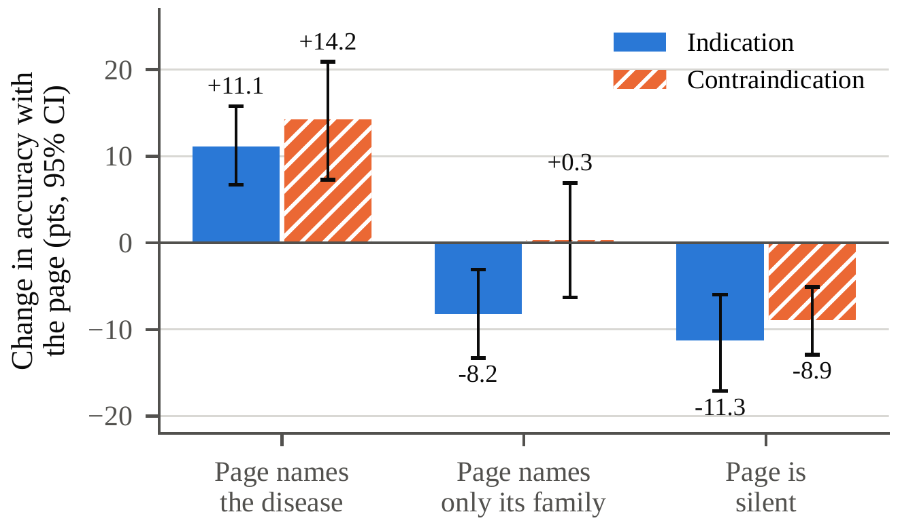</div>

| Page type | ✅ Uses: gain | ⛔ Limits: gain | ⛔ Declines (no page → page) |
|---|---:|---:|---|
| 🟢 Names the disease | +11.1 | +14.2 | 36.2 → 41.6 |
| 🟡 Names only the family | −8.2 | +0.3 | 42.1 → 54.4 |
| ⚪ Says nothing | −11.3 | −8.9 | 43.3 → 76.2 |

Pooled over the three 7–8B models. The gap between uses and limits on a named page is −3.1 [−11.6, +5.1], so it is not significant.
**What it means:** when the text names the limit, the model reads it just fine. The real problem is that prose rarely names it.

### 6️⃣ Control: the gap is about limits, not about any second relation

We run the same test on Hetionet, with two *positive* relations: **treats** and **palliates**.

| Hetionet | treats | palliates | OR |
|---|---:|---:|---|
| Named in Wikipedia | 57.3% | 56.1% | 1.05 (p = 0.70) |

**What it means:** two kinds of "good" facts show no gap. The gap appears only when one side is a risk.

### 7️⃣ The naming sentence really states the relation

A disease name in the text does not always say *how* the drug and the disease are linked. So we check each naming sentence.

- 🤖 **Model judge.** Qwen2.5-7B reads the sentence and picks: *treats*, *must not be used*, *may cause or worsen it / needs caution*, or *no link*.
- 👥 **Four annotators** label 160 named sentences with the relation hidden (Wikipedia and label, 40 per relation each).
- 🔍 **Recall check.** The same annotators read 50 label *Contraindications* sections where the matcher found nothing.

| Source | OR, named | OR, sentence states the relation |
|---|---|---|
| 📖 Wikipedia | 2.68 [2.16, 3.34] | **2.70** [2.15, 3.39] |
| 🔬 PubMed | 2.83 [2.34, 3.41] | **2.09** [1.71, 2.57] |
| 🏷️ Whole FDA label | 1.05 [0.88, 1.25] | **0.88** [0.73, 1.07] |

| Check | Result |
|---|---|
| Annotator agreement | Fleiss' κ = **0.89** (audit), **0.92** (recall) |
| Judge vs. annotators | **95.5%** agreement, κ = 0.92 |
| Named sentences that state the relation | **88.6%** of uses, **93.3%** of limits |
| Limits written as warnings / formal contraindications | **82–83%** / 10–11% |
| Recall check: fact absent from the section | **45 of 50**; only 3 are worded differently |

**What it means:** the gap holds when each sentence must state the relation, and the label stays even. Most of PrimeKG's "contraindications" are written as warnings, so we count both as safety statements.

### 8️⃣ Routing safety questions to the label helps when the label names the fact

We ask the same 726 harder questions with a page cut from the drug's whole FDA label, and compare it with the usual prose page.

| ⛔ Limit questions | Prose page | Label page | Difference [95% CI] |
|---|---:|---:|---|
| 🟢 Label names the answer (135) | 40.0 | 55.8 | **+15.8** [8.6, 23.2] |
| ⚪ Label is silent (211) | 17.1 | 12.2 | −4.9 [−8.2, −1.7] |

Accuracy in %, pooled over the three 7–8B models. For ✅ use questions the label adds little (+3.4 when it names them) and hurts when it is silent (−11.0), so uses stay with prose. Over all questions, routing changes accuracy by +1.5 [−0.2, +3.2].
**What it means:** send safety questions to the label, but first check that the label names the condition.

---

## 💡 What it means

<div align="center">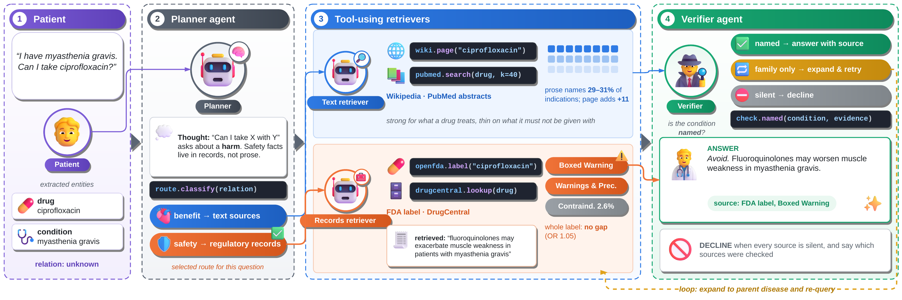</div>

- 🧭 **Route by question type.** For "what does this drug treat?", prose works. For "who must not take it?", go to the FDA label.
- 🔍 **Do not trust a closed-book "no".** A model that misses a limit does not show that the limit is absent.
- 📏 **Check limits on their own.** An overall drug score hides the gap. We report uses and limits apart.

---

## ⚠️ Limitations

- 🔤 Our matcher works on names. In a check of 50 label sections it missed 3 limits written in other words.
- 🗄️ PrimeKG is our ground truth. Some of its edges may be wrong or old.
- 🌐 We measure today's Wikipedia and PubMed. Both change over time.
- 🤖 We test open models up to 14B. We do not test large closed models.
- 🇺🇸 The FDA label covers US drugs only. 472 of our 574 drugs have one.

## 🔭 Future work

- 🔁 Build and evaluate the full agent: we test only its routing step.
- 🌍 Add labels from other agencies (EMA, PMDA) and other languages.
- 📈 Test larger and closed models with the same questions.
- 🧬 Look for the same gap in other "good vs. risk" pairs, like gene benefits and side effects.

---

## ▶️ Run it

```bash
# 1. Check every shipped number (5 minutes, no GPU, no network)
bash tools/check_results.sh          # expect: identical: 14

# 2. Test the full pipeline on tiny fake data (minutes)
bash run_all.sh --smoke

# 3. Run everything from scratch (SLURM cluster)
export CONTACT="you@example.org"     # for the Wikipedia User-Agent
bash run_all.sh
bash run_all.sh --status

# 4. Relation check, annotation scoring and routing test (after step 3)
bash relcheck.sh quick               # keyword check, RBG intervals, blank audit sheets
bash relcheck.sh submit              # model judge + label-page runs (SLURM)
bash relcheck.sh report              # judge and routing tables
bash relcheck.sh audit AUDIT.csv RECALL.csv   # one *_label column per annotator
```

All settings live in [`config.sh`](config.sh). Each step resumes if it stops.

## 🗂️ What is where

| Path | What it holds |
|---|---|
| 📜 `run_all.sh`, `pipeline.sh` | Run the whole study, step by step |
| 🔎 `relcheck.sh` | Relation check, annotation scoring and routing test |
| ⚙️ `config.sh`, `config_extend.sh` | All settings: account, models, data links |
| 🐍 `scripts/` | Analysis and model scripts |
| 🗄️ `derived_data/` | PrimeKG and Hetionet files the analysis reads |
| 📊 `results/` | Every number, log and per-question answer ([`SUMMARY.md`](results/SUMMARY.md)) |
| 🧪 `tests/`, `tools/` | Fake-data test and the result checker |
| 🎨 `paper/` | Figure sources (`build_figures.py`, draw.io files) |
| 🖼️ `docs/figures/` | Figures for this page |

## 📝 Cite

```bibtex
@inproceedings{rayeed2027label,
  title     = {{LABEL}: {L}iterature {A}symmetry between {E}fficacy and {L}imits in {D}rug {K}nowledge and {L}anguage {M}odels},
  author    = {Rayeed, S M and Stewart, Charles and Ma, Yao},
  year      = {2027}
}
```
